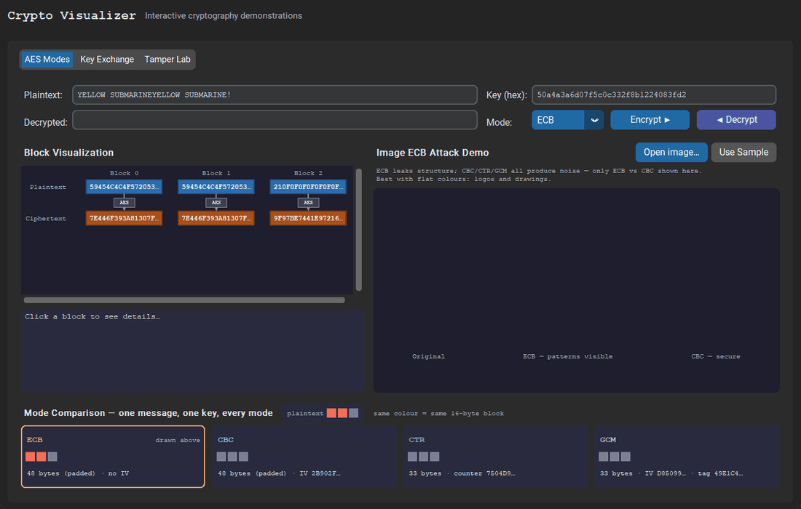

# Crypto Visualizer

[](https://github.com/erihhh6/crypto-visualizer/actions/workflows/ci.yml)
[](https://www.python.org/)
[](LICENSE)

> An interactive Python GUI application that makes cryptographic concepts visible and tangible.



---

## What this visualizes

- **AES Modes** — ECB, CBC, CTR, GCM with per-block hex visualization, hover tooltips, and click-to-inspect
- **ECB Penguin Attack** — load any BMP image and see why ECB mode is dangerous (structural patterns survive encryption)
- **Key Exchange** — Diffie-Hellman (2048-bit, RFC 3526 Group 14) and ECDH (SECP256R1) with step-by-step animation
- **DH vs ECDH size comparison** — equivalent security levels at dramatically different key sizes

---

## Why it matters

AES mode selection is one of the most common cryptographic mistakes in real software — ECB mode leaks structure even when the key is strong. Key exchange protocols underpin every TLS connection, SSH session, and secure messaging app. Seeing these algorithms execute step by step, with real cryptographic values, builds the intuition needed to make correct security decisions.

---

## Installation

```bash
pip install -r requirements.txt
python main.py
```

Requires Python 3.11+.

---

## Development

```bash
pip install -r requirements-dev.txt

python -m pytest --cov   # tests + coverage (any warning fails the run)
python -m ruff check .   # lint
python -m ruff format .  # format
python -m mypy           # strict type check
```

CI runs the same checks on every push and pull request, with tests on
Python 3.11–3.15. Tool configuration lives in `pyproject.toml`.

GUI tests (`tests/gui/`) open real windows, so expect brief flashes on your
desktop; CI runs them under `xvfb`, and without any display they are skipped.
Known bugs are recorded as tests marked `known_bug(...)` (strict expected
failures) until the commit that fixes them removes the marker.

---

## Concepts demonstrated

| Concept | What the app shows | Reference |
|---|---|---|
| AES-ECB | Identical plaintext blocks produce identical ciphertext blocks | NIST FIPS 197 §6.1 |
| AES-CBC | Each block XOR'd with previous ciphertext — patterns disappear | NIST SP 800-38A |
| AES-CTR | Stream cipher mode; no padding needed; parallelisable | NIST SP 800-38A |
| AES-GCM | Authenticated encryption; includes 128-bit integrity tag | NIST SP 800-38D |
| ECB Penguin Attack | Encrypting a BMP pixel-by-pixel in ECB preserves visual structure | Schneier, *Applied Cryptography* |
| Diffie-Hellman | Public/private value exchange; shared secret via modular exponentiation | RFC 3526 |
| ECDH | Same idea on an elliptic curve; much smaller keys for same security | RFC 8422 |
| Key size equivalence | 256-bit ECDH ≈ 3072-bit DH ≈ 128-bit symmetric security | NIST SP 800-57 Table 2 |

---

## Project structure

```
crypto-visualizer/
├── main.py                    # Entry point
├── modules/
│   ├── aes_modes.py           # AES ECB/CBC/CTR/GCM encrypt/decrypt + per-block detail
│   └── key_exchange.py        # DH + ECDH step-by-step + comparison
├── gui/
│   ├── main_window.py         # CustomTkinter window + tab view
│   ├── aes_tab.py             # Block canvas, ECB image demo, comparison panel
│   └── key_exchange_tab.py    # Step animator, matplotlib curve, comparison table
├── assets/
│   └── sample.bmp             # Test image for ECB attack demo
└── requirements.txt
```

---

## References

- **NIST FIPS 197** — Advanced Encryption Standard (AES): https://csrc.nist.gov/publications/detail/fips/197/final
- **NIST SP 800-38A** — Block Cipher Modes of Operation (ECB, CBC, CTR): https://csrc.nist.gov/publications/detail/sp/800-38a/final
- **NIST SP 800-38D** — GCM Mode: https://csrc.nist.gov/publications/detail/sp/800-38d/final
- **RFC 3526** — More Modular Exponential (MODP) Diffie-Hellman groups for IKE: https://www.rfc-editor.org/rfc/rfc3526
- **RFC 8422** — Elliptic Curve Cryptography (ECC) Cipher Suites for TLS: https://www.rfc-editor.org/rfc/rfc8422
- **NIST SP 800-57** — Recommendation for Key Management: https://csrc.nist.gov/publications/detail/sp/800-57-part-1/rev-5/final
- **PyCA cryptography** — https://cryptography.io/en/latest/
